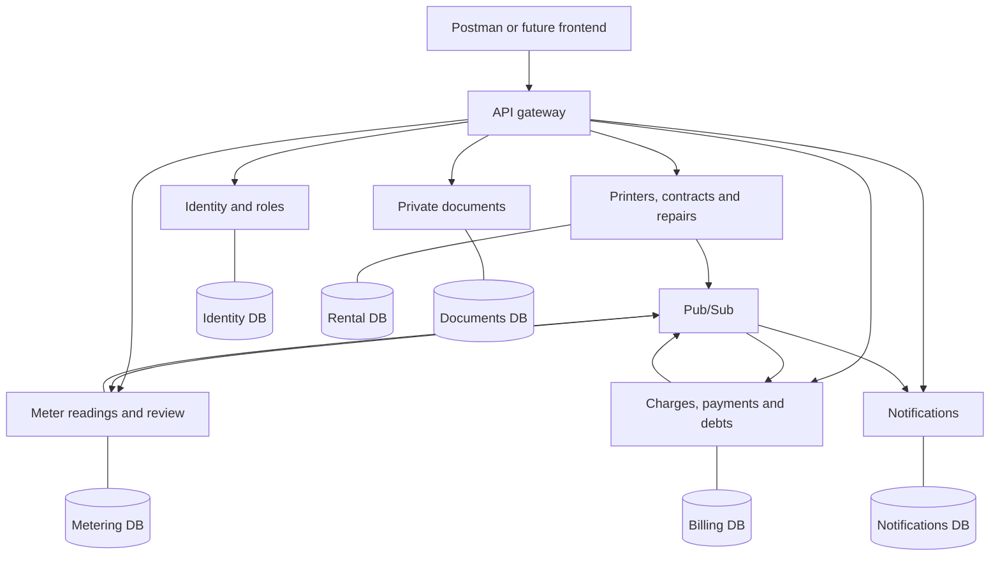

# Printer rental administration - public source

A Java / Spring Boot backend for printer rental: contracts, four-category meter
readings, usage-based monthly charges, payments, repairs and customer records.

## Business workflow

1. Staff configure a printer contract, initial counters, monthly fee, page tariffs,
   VAT rate and payment deadline.
2. Customers submit readings. Normal usage is accepted; anomalies wait for review.
3. Billing saves the calculation breakdown, estimates missing usage under the
   agreed rules and corrects later bills when actual readings arrive.
4. Payments cover the oldest debts; excess remains as an advance.
5. Customers view their own records and request repairs for active contracts.

## Architecture



Each domain service owns a PostgreSQL database and credentials on one server.
Outbox insertion commits with business changes. A short lease reserves an event;
HTTP publication runs without holding the DB connection. Consumers deduplicate
event IDs using an inbox. Delivery is at least once; revision checks handle
out-of-order projections. There is no shared business-model library.

**Why seven services?** This is a learning prototype for independent delivery,
data ownership and asynchronous recovery. A modular monolith would normally be
simpler for a small company. Extra services introduce operational cost and
eventual consistency; their count is an educational choice.

The prototype exposes backend APIs and Postman examples. A customer web frontend
and bank/payment-provider integration are future work. The hosted environment is
private and is not a public demo endpoint.

## Public repositories

| Repository | Responsibility |
|---|---|
| [psi-api-gateway](https://github.com/Printerrenta/psi-api-gateway-public) | HTTP routing |
| [psi-identity-service](https://github.com/Printerrenta/psi-identity-service-public) | Application users and roles |
| [psi-rental-service](https://github.com/Printerrenta/psi-rental-service-public) | Printers, contracts and repairs |
| [psi-document-service](https://github.com/Printerrenta/psi-document-service-public) | Private documents |
| [psi-metering-service](https://github.com/Printerrenta/psi-metering-service-public) | Four counters, review policies and reminders |
| [psi-billing-service](https://github.com/Printerrenta/psi-billing-service-public) | Charges, corrections, payments and debt allocation |
| [psi-notification-service](https://github.com/Printerrenta/psi-notification-service-public) | Inbox deduplication and customer notifications |
| [GCP-IFRA](https://github.com/Printerrenta/GCP-IFRA-public) | Terraform reference and mock tests |

## Technology

Java 21, Spring Boot, PostgreSQL, Flyway, JUnit, Testcontainers, ArchUnit,
Docker Compose, GCP Cloud Run, Pub/Sub, Terraform and Cloud Build.

## Local setup

Install Git, Node.js, JDK 21 and Docker Desktop with Linux containers. PowerShell:

```powershell
git clone https://github.com/Printerrenta/PSI-BE-public.git PSI-BE
Set-Location PSI-BE
npm.cmd ci
npm.cmd run services:clone
Copy-Item .env.example .env.local
notepad .env.local
docker compose --env-file .env.local up --build -d
```

The clone script checks out matching public service snapshots using services.json.
Supply your own development Auth/JWKS and S3-compatible storage settings. The
sample contains placeholders; login is not an offline local feature. Never put
operating credentials into Git. Change API_PORT if 8080 is occupied and set the
same base URL in Postman. Existing database volumes require an explicit upgrade;
never delete a populated volume to upgrade the schema.

## Tests and API reference

Each service builds independently with npm run build, npm test and
npm run test:integration (Docker required by default). Unit/domain, HTTP security,
database, migration and concurrency tests are in the service repositories.
The integration workspace also contains operator migration tools and database
tests; its build does not compile all services at once.

- [Accounting API](docs/accounting-api.md)
- [Architecture decisions and OOP/SOLID](docs/architecture-decisions.md)
- [Reading and billing requirements](docs/metering-billing-requirements.md)
- [Postman collections](postman)

## Synchronization and source fidelity

This repository is generated after successful private main CI. Application code,
tests, migration SQL and build manifests are copied byte for byte. Only public
presentation, environment examples, public repository links and equivalent public
release pins are adapted. PUBLIC_MIRROR.json records the source commit and per-file
SHA256 checksums. Source tags preserve matching public snapshots for release pins.

This public Git history starts independently. Production deployment settings,
credentials, private release evidence and private Git history are omitted. The
publisher uses a reviewed file allowlist and secret scans; detected unsafe content
blocks publication. GCP deployment continues from the private originals.
Report issues here; generated-file edits should be integrated into the source
before synchronization. No cloud credentials are needed to inspect or test code.
